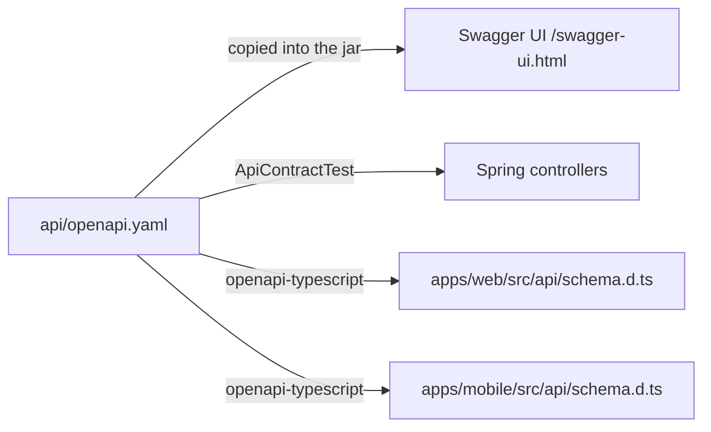

# API

## Contract first

`api/openapi.yaml` is the single source of truth for the HTTP API.



To change the API:

1. Edit `api/openapi.yaml` and lint it: `./scripts/lint-contract.sh`.
2. Regenerate the client types: `./scripts/api-generate.sh` (commit the generated files).
3. Implement the change in the backend controller and DTO records.
4. `mvn verify` fails (`ApiContractTest`) if a path or method exists on one side only;
   `npm run typecheck` in each app fails if the apps use the API in a way the contract no longer allows.
5. CI re-runs all of this and also checks that the generated types were committed.

Swagger UI at `http://localhost:8080/swagger-ui.html` renders the contract. Use the
**Authorize** button with a token from `POST /api/v1/auth/otp/verify`.

## Conventions

- Base path `/api/v1`. JSON everywhere except uploads (`multipart/form-data`) and file downloads.
- Authentication: `Authorization: Bearer <JWT>` on everything except `/api/v1/auth/**` and
  `/api/v1/public/**`.
- `/api/v1/admin/**` is the PMD back office and requires the `ADMIN` role.
- IDs are UUIDs. Lots and transports also have human codes (`GP-7KQ29XHD`, `TR-4M8Q2ZKD`).
- Timestamps are ISO-8601 instants in UTC. Dates (`plannedPickupDate`) are `YYYY-MM-DD`.
- Weights are grams, purity is percent (0-100), money is a decimal amount plus `PEN` or `USD`.
- Response objects always include every property; absent values are `null`.
- State-changing actions are explicit sub-resources (`POST /transports/{id}/pickup`) rather than
  generic `PATCH status`, so each one has its own authorization and validation.
- Device-recorded facts (photo `capturedAt`, GPS `recordedAt`) are accepted for offline sync; the
  server also stores its own receipt time.

## Errors

All errors are [RFC 7807](https://www.rfc-editor.org/rfc/rfc7807) problem details:

```json
{
  "type": "about:blank",
  "title": "Conflict",
  "status": 409,
  "detail": "Transport in status AT_MINER does not allow: pick up",
  "code": "INVALID_STATE"
}
```

`code` is stable and meant for programs; the apps translate it (`errors.<CODE>` keys in their i18n
files) and fall back to `detail`. Validation errors (400 `VALIDATION_FAILED`) add `errors`,
a map of field to message.

| HTTP | Meaning | Codes |
| --- | --- | --- |
| 400 | Invalid input | `VALIDATION_FAILED`, `INVALID_PHONE`, `INVALID_DOCUMENT_NUMBER`, `INVALID_COORDINATES`, `INVALID_PURITY`, `INVALID_WEIGHT`, `INVALID_AMOUNT`, `INVALID_CURRENCY`, `FILE_EMPTY`, `FILE_TOO_LARGE`, `FILE_TYPE_NOT_ALLOWED`, `PHOTO_REQUIRED`, `NOTES_REQUIRED`, `REASON_REQUIRED`, `CAPTURED_IN_FUTURE`, `RECORDED_IN_FUTURE`, `ENTITY_DETAILS_REQUIRED`, `COUNTERPARTY_REQUIRED`, `COUNTERPARTY_ROLE_NOT_ALLOWED`, `COUNTERPARTY_ROLE_IMMUTABLE`, `SELF_RELATIONSHIP`, `MINE_SITE_REQUIRED`, `LAB_NAME_REQUIRED`, `LOT_REQUIRED`, `PARTIES_REQUIRED`, `PAYMENT_DETAILS_REQUIRED`, `DOCUMENT_KIND_REQUIRED` |
| 401 | Not authenticated | `UNAUTHENTICATED`, `OTP_INVALID`, `OTP_EXPIRED`, `USER_SUSPENDED` |
| 403 | Not allowed | `ROLE_REQUIRED`, `ONBOARDING_NOT_APPROVED`, `NOT_A_PARTICIPANT`, `NOT_OWNER`, `FILE_ACCESS_DENIED`, `NOT_APPLICABLE` |
| 404 | Not found | `NOT_FOUND`, `NOT_AVAILABLE` (OTP endpoints in Cognito mode) |
| 409 | Not allowed in the current state | `INVALID_STATE`, `CONCURRENT_MODIFICATION`, `DUPLICATE_OR_CONFLICT`, `ALREADY_CONFIRMED`, `ALREADY_APPROVED`, `PICKUP_NOT_AUTHORIZED`, `LOT_NOT_ON_TRANSPORT`, `LAB_RESULT_EXISTS`, `LAB_NOT_VERIFIED`, `RELATIONSHIP_EXISTS`, `ROLE_NOT_SET`, `ROLE_ALREADY_SET`, `ROLE_NOT_ALLOWED` |
| 422 | Business rule not met | `ONBOARDING_INCOMPLETE`, `EVIDENCE_REQUIRED`, `RELATIONSHIP_REQUIRED`, `MINER_NOT_APPROVED`, `COLLECTOR_NOT_APPROVED`, `COUNTERPARTY_NOT_APPROVED`, `COUNTERPARTY_NOT_ON_PLATFORM` |
| 429 | Too many requests | `OTP_RATE_LIMITED` |
| 500 | Unexpected | `INTERNAL_ERROR` (details only in server logs) |

## Endpoint map

Who may call each endpoint. "Participant" means the miner, transporter or collector of that
transport or lot.

### Auth and profile

| Method and path | Caller |
| --- | --- |
| `GET /auth/config` | anyone: tells the apps whether to use local OTP or Cognito |
| `POST /auth/otp/request`, `POST /auth/otp/verify` | anyone (local mode only) |
| `GET /me`, `PATCH /me` | signed in |
| `PUT /me/role` | signed in, once; `ADMIN` not allowed |
| `GET /participants?role=&q=` | approved participants: directory of approved users |

### Onboarding

| Method and path | Caller |
| --- | --- |
| `GET /onboarding/me`, `PUT /onboarding/me` | applicant (creates the draft on first call) |
| `POST /onboarding/me/documents` | applicant (multipart: `kind`, `file`) |
| `POST /onboarding/me/submit` | applicant |
| `GET /admin/onboarding`, `GET /admin/onboarding/{id}` | PMD |
| `POST /admin/onboarding/{id}/approve`, `/request-corrections`, `/reject` | PMD |
| `GET /admin/users` | PMD |

### Relationships

| Method and path | Caller |
| --- | --- |
| `GET /relationships` | owner, or approved counterparty |
| `POST /relationships` | approved Transporter (details) or Collector (`counterpartyUserId`) |
| `PUT /relationships/{id}` | owner, after clarification was requested |
| `GET /admin/relationships`, `POST /admin/relationships/{id}/approve`, `/request-clarification`, `/reject` | PMD |

### Lots

| Method and path | Caller |
| --- | --- |
| `GET /lots?status=` | participant (miner, assigned transporter, receiving collector) |
| `POST /lots` | approved Miner |
| `GET /lots/{id}` | participant or PMD |
| `POST /lots/{id}/photos` | owning Miner, lot `OPEN` (multipart: `file`, `latitude`, `longitude`, `accuracyMeters`, `capturedAt`) |
| `POST /lots/{id}/complete` | owning Miner |
| `POST /lots/{id}/miner-lab-result` | owning Miner (multipart: `file`, `purityPct`, `weightGrams`, `labName`) |
| `GET /lots/{id}/ledger` | participant or PMD |
| `GET /admin/lots` | PMD |

### Transports

| Method and path | Caller |
| --- | --- |
| `GET /transports`, `GET /transports/{id}` | participant (PMD via `/admin/transports`) |
| `POST /transports`, `PUT /transports/{id}` (amend) | Transporter with approved relationships to both parties |
| `POST /transports/{id}/miner-confirm` | the Miner, with a `READY_FOR_TRANSPORT` lot |
| `POST /transports/{id}/collector-confirm` | the Collector |
| `POST /transports/{id}/decline` | the Miner or the Collector |
| `POST /transports/{id}/cancel` | the Transporter, before pickup |
| `POST /transports/{id}/depart`, `/arrive-at-miner`, `/pickup`, `/location`, `/arrive-at-collector` | the Transporter (body: GPS reading) |
| `POST /transports/{id}/approve-pickup`, `/receive` | the Collector |
| `POST /transports/{id}/handover` | the Miner |
| `POST /transports/{id}/finalize` | the Transporter |

### Lab and settlement

| Method and path | Caller |
| --- | --- |
| `GET /lots/{id}/lab-result` | participant or PMD |
| `POST /lots/{id}/lab-result` | the receiving Collector, lot `DELIVERED` (multipart) |
| `GET /admin/lab-results`, `POST /admin/lots/{id}/lab-result/resolve` | PMD |
| `GET /settlements` | Miner or Collector of each settlement |
| `GET /lots/{id}/settlement` | participant or PMD |
| `POST /lots/{id}/settlement/proposals` | the Collector, after the lab check is verified |
| `POST /lots/{id}/settlement/accept`, `/dispute` | the Miner |
| `POST /lots/{id}/settlement/mark-paid` | the Collector, after PMD validation |
| `GET /admin/settlements`, `POST /admin/lots/{id}/settlement/validate`, `/reject` | PMD |

### Files, notifications, public

| Method and path | Caller |
| --- | --- |
| `GET /files/{id}`, `GET /files/{id}/content` | uploader, PMD, or whoever the owning module's `FileAccessPolicy` allows |
| `GET /notifications`, `POST /notifications/{id}/read`, `POST /notifications/read-all` | signed in (own inbox) |
| `POST /devices`, `POST /devices/unregister` | signed in (push token) |
| `GET /public/passports/{lotCode}` | anyone |
