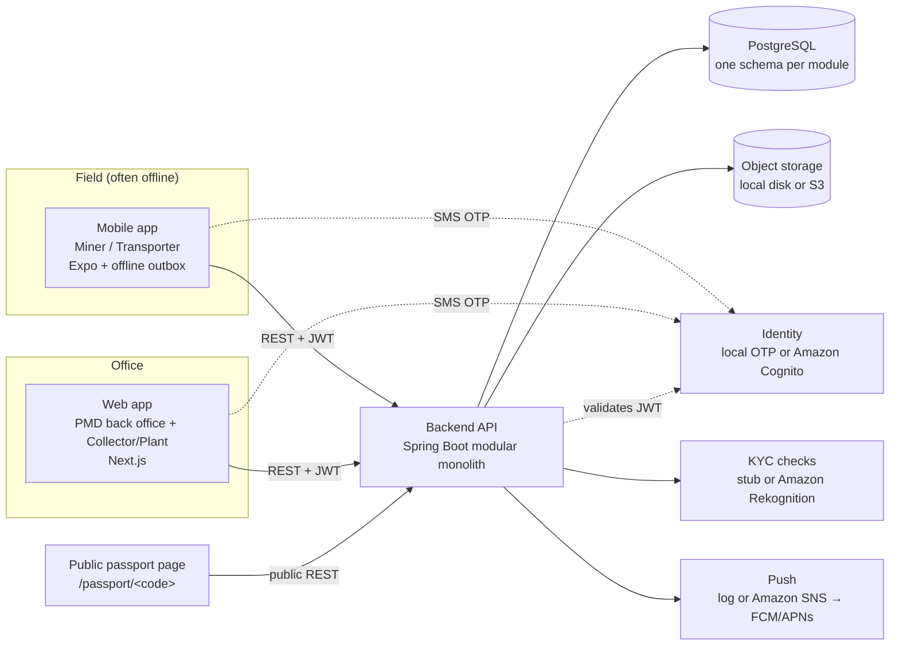
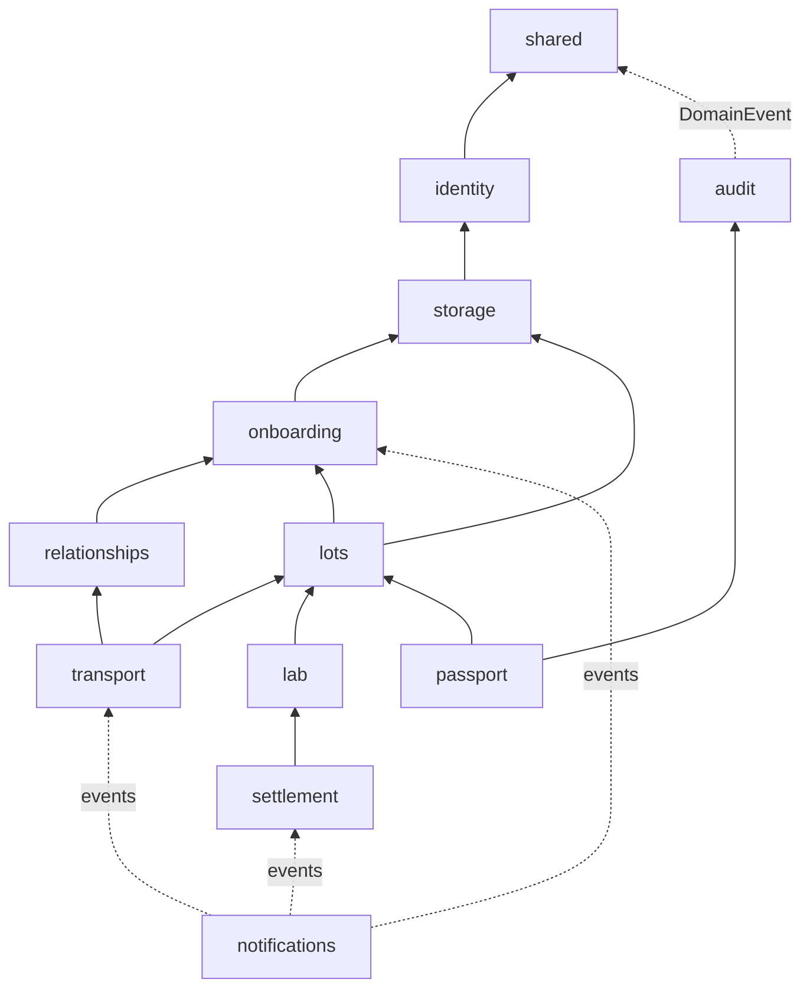

# Architecture

## System overview



Three clients, one API, one database. The API is a **modular monolith**: deployed as one service,
organised as independent modules with enforced boundaries, so any module can later become its own
service without rewriting the domain.

## Backend modules

Every direct sub-package of `com.pmd.goldpassport` is a module (Spring Modulith). The rules,
enforced by `ModularityTest`:

- Types in a module's **base package** are its public API (interfaces, events, read models).
- Everything in sub-packages (`internal`, `web`, `kyc`, `push`, `security`) is private to the module.
- No dependency cycles between modules.

| Module | Owns | Public API | Depends on |
| --- | --- | --- | --- |
| `shared` | Roles, errors, `DomainEvent`, `GeoPoint`, validators, hashing, `Clock` | everything (shared kernel) | none |
| `identity` | Users, OTP login, JWT validation, `CurrentUser` | `CurrentUser`, `UserAccounts` | shared |
| `storage` | Files (evidence, documents), content sniffing, SHA-256, access policies | `FileStorage`, `FileAccessPolicy`, `StoredFileInfo` | shared, identity |
| `onboarding` | KYC applications, documents, automated checks, participant directory | `ParticipantDirectory`, `OnboardingEvent` | shared, identity, storage |
| `relationships` | Commercial relationships and their review | `RelationshipQueries`, `RelationshipEvent` | shared, identity, onboarding |
| `lots` | Lotes, extraction evidence, custody state | `LotCustody`, `LotView`, `LotStatus`, `LotEvent` | shared, identity, storage, onboarding |
| `transport` | Transports, confirmations, GPS checkpoints | `TransportEvent` | lots, relationships, onboarding, identity |
| `lab` | Collector lab checks and discrepancies | `LabQueries`, `LabEvent` | lots, storage, identity |
| `settlement` | Payment proposals, validation, payment record | `SettlementEvent` | lots, lab, identity |
| `notifications` | Inbox, device tokens, push delivery | none (event listener) | identity + every module's events |
| `audit` | Hash-chained custody ledger | `LedgerQueries` | shared |
| `passport` | Ledger endpoint and public passport | none (web only) | lots, audit |



Running `mvn verify` also writes PlantUML diagrams of the actual module graph to
`backend/target/spring-modulith-docs` (uploaded as a CI artifact).

### Inside a module

```
lots/
  LotCustody.java        public API used by transport, lab, settlement
  LotView.java           read model shared with other modules
  LotStatus.java         public enum
  LotEvent.java          domain event (public)
  internal/
    Lot.java             JPA entity + state machine guards
    LotEvidence.java     child entity
    LotRepository.java   Spring Data repository
    LotService.java      use cases; implements LotCustody
    LotProperties.java   pmd.lots.* configuration
    LotFileAccessPolicy  who may download lot files
  web/
    LotController.java   REST endpoints + request/response records
```

State transitions live in the entities (`Lot.complete()`, `Transport.pickUp()`...) and throw
`InvalidStateException` (HTTP 409) when not allowed. Services orchestrate: load, check the actor,
call the entity, publish an event. Controllers only map HTTP to services and DTOs.

### How modules talk

Two mechanisms, chosen deliberately:

1. **Synchronous API calls** when two changes must commit together. Example: picking up a lot calls
   `LotCustody.transferToTransporter(...)` inside the transport transaction, so a transport can
   never be `IN_TRANSIT` while its lot still says the miner has it.
2. **Domain events** for side effects. Every event implements `shared.DomainEvent`.
   - `audit.LedgerService` listens **synchronously** (`@EventListener`), in the same transaction:
     no business change without its ledger entry.
   - `notifications` and the onboarding KYC check use `@ApplicationModuleListener`
     (asynchronous, after commit, own transaction). Spring Modulith's event publication registry
     (table `event_publication`) stores each event until its listener completes and republishes
     unfinished ones on restart, so a crash does not lose notifications.

### Request lifecycle

1. `SecurityConfig` validates the bearer JWT (HS256 local tokens or Cognito JWKS).
2. `PmdJwtAuthenticationConverter` maps the token subject to a platform user (provisioning Cognito
   users on first call) and sets authority `ROLE_<role>` from the **database**.
3. URL rules: `/api/v1/admin/**` needs `ADMIN`; `/auth/**` and `/public/**` are open; everything else
   needs a valid token.
4. Controllers receive `CurrentUser` as a method argument (`CurrentUserArgumentResolver`).
5. Services do the fine-grained checks: role (`requireRole`), approval
   (`ParticipantDirectory.requireApproved`), participation (e.g. only this lot's miner).
6. Errors become RFC 7807 problem details with a stable `code` (`GlobalExceptionHandler`), which the
   apps translate.

### Adapters (ports) and configuration

| Port | Local default | AWS implementation | Switch |
| --- | --- | --- | --- |
| Authentication | OTP logged + HS256 JWT (`pmd.auth.mode=local`) | Amazon Cognito user pool, passwordless SMS OTP | `PMD_AUTH_MODE=cognito`, `PMD_COGNITO_*` |
| `ObjectStore` | Local filesystem | Amazon S3 with SSE (KMS optional) | `PMD_STORAGE_PROVIDER=s3`, `PMD_S3_*` |
| `IdentityVerifier` | Stub (always `NEEDS_REVIEW`) | Amazon Rekognition face compare + text detection | `PMD_KYC_PROVIDER=aws` |
| `PushGateway` | Log | Amazon SNS mobile push (FCM / APNs) | `PMD_PUSH_PROVIDER=sns`, `PMD_SNS_*` |

All settings are in `backend/src/main/resources/application.yml` under `pmd.*` and can be set by
environment variables. Business tolerances (`pmd.lab.*`, `pmd.transport.location-mismatch-km`,
`pmd.lots.min-photos`) are configuration, not code.

## Data model

Flyway owns the schema (`backend/src/main/resources/db/migration`, one migration file per module).
Each module has its own PostgreSQL schema and there are **no cross-schema foreign keys**: modules
reference each other by UUID only.

| Schema | Tables |
| --- | --- |
| `identity` | `users`, `otp_challenges` |
| `storage` | `files` |
| `onboarding` | `applications`, `application_documents` |
| `relationships` | `relationships` |
| `lots` | `lots`, `lot_evidence` |
| `transport` | `transports`, `checkpoints` |
| `lab` | `lab_results` |
| `settlement` | `settlements`, `proposals` |
| `notifications` | `notifications`, `device_tokens` |
| `audit` | `ledger_entries` (append-only trigger) |
| `public` | `flyway_schema_history`, `event_publication` (Spring Modulith) |

Aggregates use optimistic locking (`version` column); a concurrent edit returns
`409 CONCURRENT_MODIFICATION`. IDs are UUIDs generated in Java.

## Web app (`apps/web`)

- Next.js App Router, all pages client components that call the API with the user's token (the
  backend is the only source of data; no server-side data fetching).
- `src/api/schema.d.ts` is generated from the contract; `src/lib/api.ts` wraps
  [openapi-fetch](https://openapi-ts.dev/openapi-fetch/) so every call is type-checked against it.
- Areas: `/admin/*` (PMD), `/collector/*` (plants, gated on approved onboarding), `/onboarding`
  (company registration), `/passport/*` (public), `/login`.
- `src/lib/i18n.tsx`: Spanish (default) and English; `src/app/globals.css`: design tokens.

## Mobile app (`apps/mobile`)

- Expo Router screens in `src/app`: `/miner/*` and `/transporter/*` tab groups, plus detail screens
  (`/lot/[lotId]`, `/transport/[transportId]`) and onboarding.
- **Offline outbox** (`src/lib/outbox.tsx`): extraction photos, handover and every GPS journey step
  are tried immediately; without signal they are stored (photos copied into app storage) and
  replayed in order when connectivity returns or the app is foregrounded. Device timestamps are
  sent, so the ledger records when things really happened. Business errors (4xx) are not retried;
  they show in Profile → Pending uploads.
- Session token in the device keystore (`expo-secure-store`); the last user profile is cached so
  the app opens without signal.
- Camera-only evidence capture (`src/lib/capture.ts`), GPS via `expo-location` (works offline).
- Push token registration (`src/lib/push.ts`) for SNS; the inbox is always the source of truth.
- Field log (`src/lib/fieldLog.ts`): the last 300 connectivity changes, send attempts (result,
  duration, size) and GPS readings (accuracy, time to fix), kept on the phone with no personal data
  (no names, numbers, coordinates or bodies; paths reduced to their pattern). It leaves the phone
  only when the user sends a field report from Profile, for field trials and support
  ([field-trial.md](field-trial.md)).
