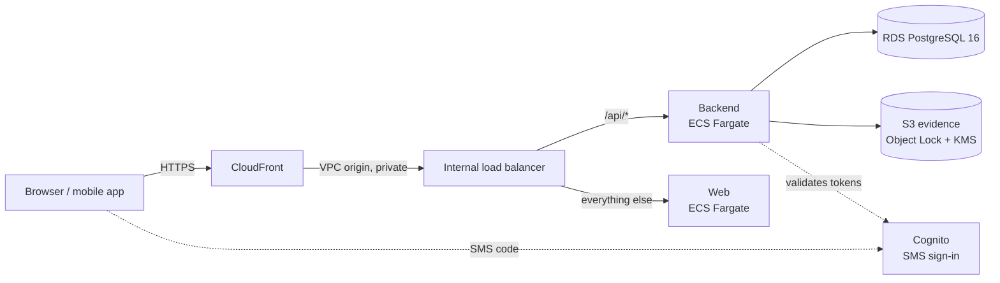

# One-click deployment to AWS

After a one-time setup (about 20 minutes), deploying is one button: **GitHub → Actions →
Deploy → Run workflow → staging or production**. The workflow builds the backend and web
Docker images and creates or updates the whole environment with AWS CDK (`infra/`).

## What gets created



One CloudFormation stack per environment, `GoldPassport-staging` and `GoldPassport-production`:

| Part | Staging | Production |
| --- | --- | --- |
| Web address | CloudFront `https://dxxxx.cloudfront.net` (API under `/api`) | same |
| Backend containers | 1 × 0.5 vCPU / 1 GB | 2 × 1 vCPU / 2 GB |
| Web containers | 1 × 0.25 vCPU / 0.5 GB | 2 × 0.5 vCPU / 1 GB |
| Database | `db.t4g.micro`, single zone, 7-day backups | `db.t4g.small`, Multi-AZ, 35-day backups, deletion protection |
| Evidence bucket | Object Lock (governance, 1 day) | Object Lock (governance, 10 years) |
| Sign-in | Cognito, passwordless SMS codes | same |
| Release phase (web) | every feature | Phase 1 (`docs/releases.md`) |

Only CloudFront is reachable from the internet. The load balancer, containers and database are
in private subnets, the database password is generated into Secrets Manager, and the containers
get AWS access from their task role (no keys anywhere). A release whose containers never become
healthy is rolled back automatically. All sizes live in `infra/lib/config.ts`.

## One-time setup

Do this once per AWS account. Use the region you deploy to everywhere (São Paulo, `sa-east-1`,
unless you set `AWS_REGION` in GitHub).

### 1. Let GitHub deploy without stored keys (AWS console)

1. Open **CloudFormation → Create stack → With new resources → Upload a template file** and
   choose `infra/setup/github-deploy-role.yml` from this repository.
2. Stack name `gold-passport-github`. Keep the parameters, except `CreateOidcProvider = false` if
   **IAM → Identity providers** already lists `token.actions.githubusercontent.com`.
3. Tick "I acknowledge that AWS CloudFormation might create IAM resources" and create.
4. When it is complete, copy the **DeployRoleArn** from the **Outputs** tab.

The role can only be used by this repository's workflows running in the GitHub environments
`staging` and `production`, and it can only hand over to the roles of step 2.

### 2. Prepare the account for CDK (AWS CloudShell)

Open **CloudShell** (the `>_` icon in the console header) in the same region and run:

```bash
npx --yes aws-cdk@2.1146.1 bootstrap
```

### 3. Create the GitHub environments

In the repository: **Settings → Environments → New environment**, twice: `staging` and
`production`. In each, under **Environment variables**, add:

| Variable | Value |
| --- | --- |
| `AWS_DEPLOY_ROLE_ARN` | the DeployRoleArn from step 1 |

For `production`, also tick **Required reviewers** and add the people who approve releases: the
Deploy button then waits for one of them before anything changes.

Optional variables (per environment):

| Variable | Effect |
| --- | --- |
| `AWS_REGION` | Deploy somewhere other than `sa-east-1` |
| `PMD_SNS_ANDROID_ARN`, `PMD_SNS_IOS_ARN` | Push notifications through SNS (see deployment-aws.md); without them, notifications stay in the in-app inbox |
| `WEB_SENTRY_DSN` | Crash reporting for the web app (docs/crash-reporting.md) |

## Deploy

**Actions → Deploy → Run workflow**, pick the environment, **Run workflow**.

- The first deployment of an environment takes 40 to 60 minutes (database and CloudFront are
  created). Later deployments take 10 to 20 minutes and cause no downtime.
- When it finishes, the run page shows the web address and the other outputs.
- Running it again without changes is safe; it only updates what changed.

## After the first deployment

1. **Make the first PMD admin.** Open the stack's **Outputs** tab in CloudFormation, copy
   `MakeAdminCommand`, paste it into CloudShell, replace `+51XXXXXXXXX` with the admin's phone
   number (international format), and run it. The person can then sign in on the web address
   with that number. The result appears in CloudWatch log group `GoldPassport-…-MakeAdminLogs…`.
   Run it again for each further admin.
2. **SMS for Peru.** New AWS accounts can only send SMS to verified numbers. In **AWS End User
   Messaging SMS**, request production access and an origination identity for Peru before real
   users sign up. Until then, add test phones under **Sandbox → Destination phone numbers**.
3. **Mobile app.** Put the `MobileApiBaseUrl` output in `EXPO_PUBLIC_API_BASE_URL` of the matching
   profile in `apps/mobile/eas.json`, then build with EAS.

## Changing things

| To change | Edit, then press Deploy |
| --- | --- |
| Sizes, counts, backups, release phase | `infra/lib/config.ts` |
| Evidence retention | `evidence` in `infra/lib/config.ts`. Switch to `COMPLIANCE` once legal has agreed the period: compliance-mode files cannot be deleted by anyone, including AWS account administrators, until it ends |
| Automatic ID checks (Rekognition) | `kycProvider: "aws"` (check Rekognition is offered in the region, or set `kycRegion`) |
| Anything else in AWS | `infra/lib/gold-passport-stack.ts` |

Pull requests run the CDK tests, synthesize both environments, lint the templates and build both
Docker images (`.github/workflows/infra.yml`), so a merged change deploys cleanly.

From a laptop (with AWS credentials for the account) the same deployment is:

```bash
cd infra && npm ci && npx cdk deploy GoldPassport-staging
```

## Not included yet

- A custom domain (`app.pmd.pe`): add an ACM certificate in `us-east-1` and the domain to the
  CloudFront distribution.
- AWS WAF rate limiting on `/api/v1/auth/**` and `/api/v1/public/**` (go-live checklist).
- Separate database roles for migrations and the application (deployment-aws.md, Database).
- Automatic rotation of the database password.
- The CloudWatch alarms and dashboard (`infra/monitoring.yml`, docs/monitoring.md) are deployed
  separately for now.
