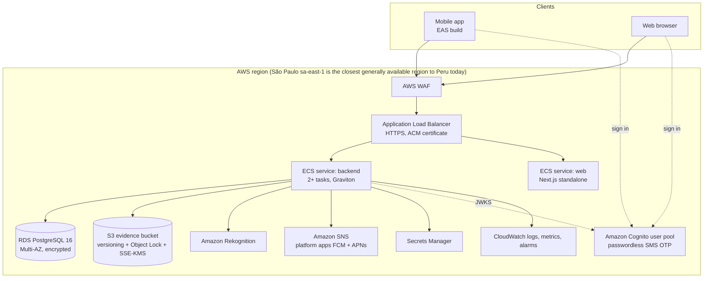

# Deploying on AWS

This is the target setup the code is ready for. Infrastructure as code (CDK or Terraform) is not
part of this repository yet; it is the first infrastructure task (see [handover.md](handover.md)).

## Target architecture

Notes:

- **Compute**: both services are stateless containers (`backend/Dockerfile`, `apps/web/Dockerfile`).
  ECS on Fargate is the simplest start; ECS on EC2 Graviton is cheaper at steady load. Both images
  are multi-arch.
- **Region**: check whether an AWS region in Chile is available when you deploy; it would cut
  latency from Peru. Review Peru's personal data law (Ley 29733) for cross-border transfer
  obligations either way.
- **Web alternative**: AWS Amplify Hosting also runs Next.js; the container keeps parity with local.
- **Mobile**: built and submitted with EAS (`apps/mobile/eas.json`); set
  `EXPO_PUBLIC_API_BASE_URL` per profile.

## Backend configuration

| Variable | Purpose | Example |
| --- | --- | --- |
| `SPRING_PROFILES_ACTIVE` | Never `local` outside laptops (it seeds demo users and a fixed OTP) | `prod` |
| `DB_URL`, `DB_USERNAME`, `DB_PASSWORD` | RDS connection (password from Secrets Manager) | `jdbc:postgresql://pmd.xxxx.sa-east-1.rds.amazonaws.com:5432/goldpassport` |
| `DB_POOL_SIZE` | Hikari pool per task | `10` |
| `DB_CONNECTION_TIMEOUT_MS` | How long a request waits for a pooled connection before failing (keep below the mobile app's 20 s timeout) | `10000` |
| `DB_LEAK_DETECTION_MS` | Log a warning with a stack trace when a connection is held longer than this | `30000` |
| `ASYNC_CONCURRENCY_LIMIT` | Most async event listeners (notifications, KYC) running at once; keep well below `DB_POOL_SIZE` | `4` |
| `PMD_AUTH_MODE` | `cognito` in AWS | `cognito` |
| `PMD_COGNITO_ISSUER_URI` | User pool issuer | `https://cognito-idp.sa-east-1.amazonaws.com/sa-east-1_AbCdEf` |
| `PMD_COGNITO_REGION`, `PMD_COGNITO_CLIENT_ID` | Returned to the apps by `/auth/config` | `sa-east-1`, `4h3...` |
| `PMD_STORAGE_PROVIDER` | `s3` | `s3` |
| `PMD_S3_BUCKET`, `PMD_S3_REGION`, `PMD_S3_KMS_KEY_ID` | Evidence bucket | `pmd-evidence-prod`, `sa-east-1`, key ARN |
| `PMD_KYC_PROVIDER`, `PMD_KYC_REGION` | `aws` enables Rekognition checks | `aws`, `sa-east-1` |
| `PMD_PUSH_PROVIDER`, `PMD_PUSH_REGION` | `sns` enables push | `sns` |
| `PMD_SNS_ANDROID_ARN`, `PMD_SNS_IOS_ARN` | SNS platform application ARNs | `arn:aws:sns:...:app/GCM/pmd-android` |
| `pmd.auth.cors-allowed-origins` | Web origin(s); set `PMD_AUTH_CORSALLOWEDORIGINS_0=https://app.example.pe` (Spring list binding) | |

AWS credentials come from the ECS task role (no keys in configuration). Task role permissions:

- `s3:PutObject`, `s3:GetObject`, `s3:DeleteObject` on the evidence bucket; `kms:GenerateDataKey`,
  `kms:Decrypt` on its key. `DeleteObject` is only used for an upload whose request failed before its
  metadata was committed (see "S3 evidence bucket"); without it such uploads are left in the bucket
  and a warning is logged.
- `rekognition:CompareFaces`, `rekognition:DetectText`
- `sns:CreatePlatformEndpoint`, `sns:Publish` on the platform applications

## Amazon Cognito

- User pool with **choice-based sign-in** and **SMS OTP** as a first factor (passwordless). This
  needs the Essentials (or Plus) feature plan.
- Phone number as the username; attribute `phone_number` required.
- App client without secret, auth flow `ALLOW_USER_AUTH` (plus `ALLOW_REFRESH_TOKEN_AUTH`).
- SMS delivery uses AWS End User Messaging SMS: request production access and an origination
  identity for Peru before go-live (the sandbox only sends to verified numbers).
- The apps send the Cognito **ID token** (it carries `phone_number`). The backend validates it
  against the pool's JWKS and provisions the platform user on first use; roles stay in the
  platform database.
- PMD admins: create the user in Cognito, sign in once, then set `role = 'ADMIN'` in
  `identity.users` (or pre-create the row with the phone number and role; it is linked on first
  sign-in).
- The Cognito helpers in `apps/*/src/lib/cognito.ts` call the public Cognito API directly; validate
  them against your pool configuration before go-live.

## S3 evidence bucket

- Block Public Access on; access only through the API (which checks permissions per file).
- Versioning on and **Object Lock in compliance mode** with a retention period agreed with legal
  (evidence must not be deletable). Object Lock must be enabled when the bucket is created.
- Default encryption SSE-KMS with a customer-managed key (`PMD_S3_KMS_KEY_ID`).
- Lifecycle rule to move objects older than 90 days to S3 Glacier Instant Retrieval.
- Uploads are stored before the database change they belong to is committed. When that change fails,
  the API deletes the object again. With versioning this only adds a delete marker, and under Object
  Lock the locked version remains until its retention ends, so add a lifecycle rule that expires
  noncurrent versions (they can only be removed once their retention has passed). Committed evidence
  is never deleted by the API.
- S3 gateway VPC endpoint so traffic does not cross the NAT gateway.

## Database

- RDS PostgreSQL 16, Multi-AZ, encrypted, automated backups (35 days) and PITR.
- Use two database roles: a **migration** role that owns the schemas (Flyway runs with it at
  startup or as a one-off task) and an **application** role with DML rights only, and only
  `INSERT, SELECT` on `audit.ledger_entries`. Set `spring.flyway.user`/`password` to the migration
  role and `DB_USERNAME`/`DB_PASSWORD` to the application role.
- Start with a single small instance; read replicas are not needed for this workload.

## Push notifications (SNS)

1. Create a Firebase project and an FCM v1 service account key for Android; an APNs key for iOS.
2. Create SNS platform applications (FCM and APNs) and put their ARNs in `PMD_SNS_*`.
3. The mobile app registers the native device token on sign-in; the backend creates the SNS
   endpoint and publishes per notification. Delivery failures are logged and never break a flow;
   the in-app inbox is authoritative.

## CI/CD

`.github/workflows/ci.yml` already validates the contract, backend, web and mobile on every pull
request. To deploy, add a job on `main` that:

1. builds and pushes both images to ECR (`docker buildx build --platform linux/arm64,linux/amd64`),
2. updates the ECS services (rolling deployment, health check `/actuator/health/readiness`),
3. runs `eas build` / `eas update` for the mobile app on release tags.

Use GitHub OIDC to assume a deployment role; do not store AWS keys in GitHub.

## Go-live checklist

- [ ] `SPRING_PROFILES_ACTIVE` is not `local`; `PMD_AUTH_MODE=cognito`
- [ ] CORS origins set to the production web domain only
- [ ] Evidence bucket with Object Lock, SSE-KMS, Block Public Access
- [ ] Separate migration and application DB roles; ledger table insert/select only
- [ ] WAF rate limiting on `/api/v1/auth/**` and `/api/v1/public/**`
- [ ] CloudWatch alarms: 5xx rate, p95 latency, DB connections, `event_publication` rows without
      completion date (stuck notifications)
- [ ] Backups restored once as a drill
- [ ] Privacy notice and consent text reviewed for Ley 29733; data retention periods agreed
