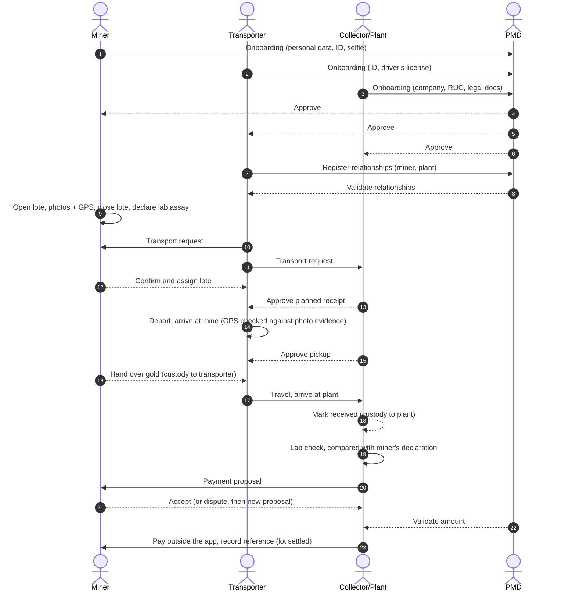
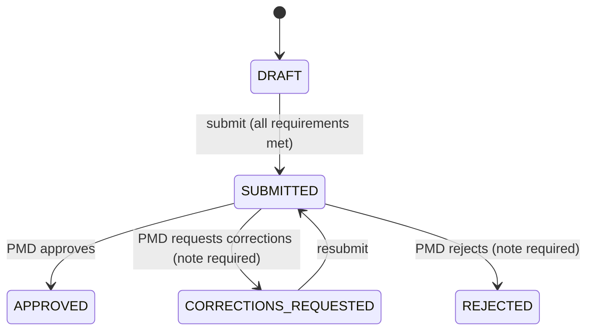
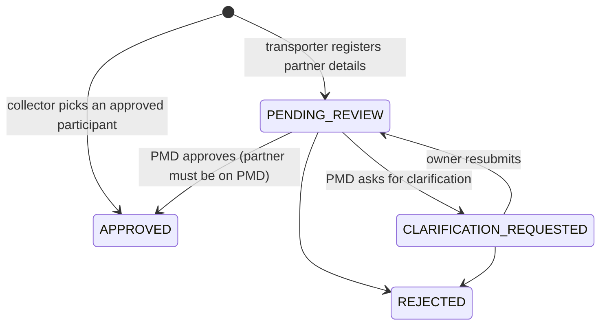
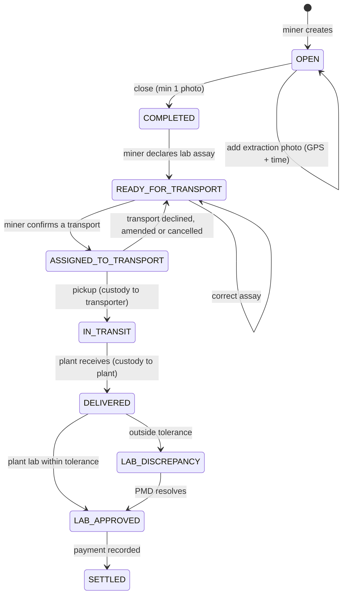
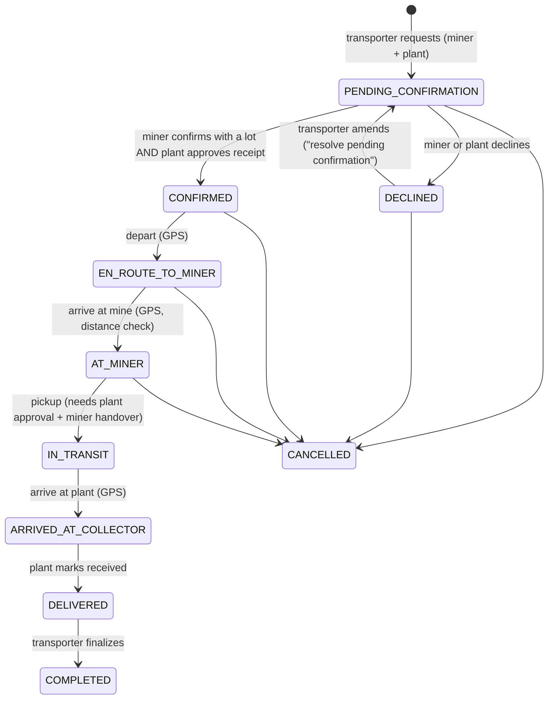
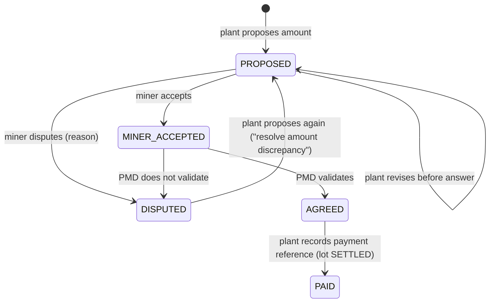

# Domain: actors, flow and rules

This document turns the four flow diagrams (Miner, Transport, Collector/Plant, Gold purity check
pipeline) into one consistent model. Where the diagrams disagreed or left a gap, the decision taken
is called out as **Decision** so the team can revisit it with the business.

## Actors

| Role | Who | Main app | Responsibilities |
| --- | --- | --- | --- |
| `MINER` | Artisanal miner (owner of the socavón) | Mobile | Onboard, open lotes, photograph extractions with GPS, declare lab assay, confirm transport, hand over gold, accept or dispute payment |
| `TRANSPORTER` | Person carrying the mineral | Mobile | Onboard (ID + driver's license), register partners, request transports, record each journey step with GPS |
| `COLLECTOR` | Collector or processing plant (company with RUC) | Web | Onboard the company, add partners, approve receipt and pickup, receive gold, record lab check, propose and record payment |
| `ADMIN` | PMD back office | Web | Verify identities, validate relationships, resolve lab discrepancies, validate payment amounts, audit lots |

A user has exactly one role, chosen once after the first login (`PUT /me/role`). `ADMIN` can never
be self-assigned; it is granted in the database (or seeded locally).

## End-to-end flow



## State machines

### Onboarding application (one per user)



Requirements before submit (`Requirements.java`):

| Role | Fields | Documents |
| --- | --- | --- |
| Miner | full name, document type (DNI/CE/passport), valid document number, email | `ID_DOCUMENT`, `SELFIE` |
| Transporter | full name, document type, valid document number, driver's license number | `ID_DOCUMENT`, `DRIVER_LICENSE` |
| Collector | company name, RUC (11 digits with valid SUNAT check digit), address, legal representative | `COMPANY_LEGAL_DOCUMENT` |

After submission, automated identity checks run asynchronously (`KycService`). The result
(`PASSED`, `NEEDS_REVIEW`, `FAILED`) is **advisory**: a PMD reviewer always decides.

Every action other than onboarding requires an `APPROVED` application
(`ParticipantDirectory.requireApproved`).

### Commercial relationship



- Transporters register Miners and Collectors by entering their details (name, DNI/RUC, phone,
  contact). The system links the record to the approved participant with that document number, if
  one exists.
- **Decision:** the Collector diagram has no PMD validation step ("select registered users, save
  relationships"), so relationships created by a Collector from the directory of approved
  participants are approved immediately. Transporter-registered relationships always go to PMD, as
  in the Transport diagram.
- **Decision:** PMD can only approve a relationship whose counterparty is an approved participant;
  otherwise the API answers `422 COUNTERPARTY_NOT_ON_PLATFORM`. A transport needs real accounts on
  both ends to confirm.
- Relationships count in both directions: a plant adding a transporter also lets that transporter
  carry gold to the plant.

### Lot (lote)



- The lot code (`GP-` + 8 characters, Crockford base32) is the public passport identifier.
- Extraction photos are camera-only in the app (no gallery), carry device GPS and capture time, and
  are hashed (SHA-256) on the server. The hash goes into the custody ledger.
- `custodian` always says who holds the gold: Miner, then Transporter, then Collector.

### Transport



**Decisions reconciling the diagrams:**

- The Miner diagram ends with "submit lote transfer to Transport user", while the Transport
  diagram has the transporter start the request. Both are kept: the transporter creates the
  request; the miner's confirmation *is* the lote transfer (the miner picks which ready lot to
  hand over).
- The Collector diagram's "Receive notification: lote ready for receipt → approve planned mineral
  receipt" is the plant's confirmation of the same request. Both confirmations are needed
  ("Both parties confirm?").
- At the mine, the Transport diagram has "receive notification or assignment of current mineral
  ownership" and the Collector diagram has "approve mineral pickup". Pickup therefore requires both
  the plant's approval and the miner's handover; only then does custody move.
- On arrival at the mine the server compares the GPS reading with the centroid of the lot's photo
  evidence. Beyond `pmd.transport.location-mismatch-km` (default 5 km) the transport is flagged
  `locationMismatch` (visible to the plant and PMD). It is a flag, not a block.
- GPS steps carry the device time (`recordedAt`) so readings recorded offline keep their real time.
  Readings more than 5 minutes in the future are rejected.

### Lab check (Collector/Plant)

- Only the receiving plant can record it, once per lot, after `DELIVERED`.
- Compared with the miner's declaration (`AssayComparison`): purity difference in percentage points
  (tolerance `pmd.lab.purity-tolerance-pct`, default 0.5) and weight difference in percent
  (`pmd.lab.weight-tolerance-pct`, default 1.0).
- Within tolerance: `APPROVED`; the plant's measurement is used for payment
  (**Decision:** the plant's lab is the reference, matching "compare with miner's results").
- Outside tolerance: `DISCREPANCY_OPEN`; PMD resolves it by setting the final purity and weight with
  a note ("Resolve discrepancies").

### Settlement (payment)



Money moves outside the app (bank transfer or cash), as in the Collector diagram. The platform keeps
the negotiation history, PMD's validation and the payment reference.

## Notifications

Every domain event can notify participants (in-app inbox + push). The routing is in
`NotificationListeners.java`; texts are in `backend/src/main/resources/i18n/messages*.properties`
(Spanish and English, per user's language). Highlights:

| Event | Who is notified |
| --- | --- |
| Onboarding submitted | PMD admins |
| Onboarding approved / corrections / rejected | Applicant |
| Relationship submitted | PMD admins |
| Transport requested / amended | Miner and plant |
| Miner confirmed ("lote ready for receipt") | Transporter and plant |
| Transporter arrived at mine | Miner and plant ("approve pickup") |
| Arrived at plant | Plant ("mark as received") |
| Lab approved | Miner and plant ("payment can start") |
| Lab discrepancy | Miner, plant and PMD admins |
| Payment proposed | Miner |
| Payment accepted by miner | Plant and PMD admins |

## Chain of custody (gold passport)

Every domain event is written, inside the same database transaction, to an append-only ledger
(`audit.ledger_entries`). Entries that belong to a lot share a chain (`lot:<id>`), and each entry's
hash covers the previous one:

```
hash = SHA-256(prevHash | chainKey | sequence | eventType | actorUserId | occurredAt | payload)
```

Changing, deleting or reordering any entry breaks every following hash. `GET /lots/{id}/ledger`
verifies the chain on every read, and the public passport shows whether it is intact. A database
trigger additionally rejects `UPDATE`/`DELETE` on the ledger table.

The public passport (`/passport/<code>` on the web) shows the timeline by role only (no names),
locations rounded to about 1 km, declared and verified figures, and the ledger's head hash. No
prices or personal data are exposed.
